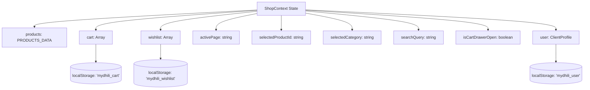

# Mydhili Boutique — Architecture & State Management Specification

> **Version:** 1.0.0  
> **Target Audience:** Software Architects, Frontend Engineers  
> **Source References:** [`src/App.jsx`](file:///c:/CODE/FL/mydhili/src/App.jsx), [`src/context/ShopContext.jsx`](file:///c:/CODE/FL/mydhili/src/context/ShopContext.jsx), [`src/main.jsx`](file:///c:/CODE/FL/mydhili/src/main.jsx)

---

## 1. Architectural Philosophy

Mydhili Boutique is architected as an ultra-fast, single-page application (SPA) focused on rendering rich editorial imagery, luxury micro-interactions, and instant state reactivity without jarring page reloads.

Key architectural priorities:
1. **Zero Layout Shifts:** Seamless view switching with scroll restoration to top.
2. **Persistent Luxury Experience:** Shopping bag, wishlist, and client profile states survive browser refreshes via atomic `localStorage` synchronization.
3. **Modular Component Isolation:** Self-contained components with clear visual tokens.
4. **Lightweight Tooling:** Powered by React 19 and Vite 8 for sub-millisecond Hot Module Replacement (HMR).

---

## 2. High-Level Component Hierarchy

```
App Root (<ShopProvider>)
└── MainApp
    ├── Header
    │   ├── AnnouncementBar
    │   ├── NavigationBar
    │   │   ├── MydhiliLogo (Vector SVG Crest & Wordmark)
    │   │   ├── DesktopNavLinks
    │   │   └── ActionIcons (Search, Wishlist, Bag, Client Profile, Mobile Toggle)
    │   ├── SearchDrawer (Real-time product suggestions)
    │   └── MobileNavDrawer (Off-canvas navigation for <= 768px)
    ├── <main> (Dynamic View Switcher via `activePage`)
    │   ├── HomePage
    │   ├── ShopPage
    │   ├── ProductDetailPage
    │   ├── BridalPage
    │   ├── BespokePage
    │   ├── AboutPage
    │   ├── CheckoutPage
    │   ├── WishlistPage
    │   ├── AccountPage
    │   └── SupportingPages (Contact & FAQs)
    ├── Footer
    │   ├── BrandEditorialStory
    │   ├── HeritageWeaverBadges
    │   ├── AtelierAddresses
    │   └── NewsletterSubscription
    └── CartDrawer (Global Slide-Over Shopping Bag)
```

---

## 3. View Switcher Routing Mechanism

Rather than relying on heavy external routing packages, the application uses an internal state-driven **View Switcher Pattern** inside [`src/App.jsx`](file:///c:/CODE/FL/mydhili/src/App.jsx):

```jsx
const renderCurrentPage = () => {
  switch (activePage) {
    case 'home':      return <HomePage />;
    case 'shop':      return <ShopPage />;
    case 'product':   return <ProductDetailPage />;
    case 'bridal':    return <BridalPage />;
    case 'bespoke':   return <BespokePage />;
    case 'about':     return <AboutPage />;
    case 'checkout':  return <CheckoutPage />;
    case 'wishlist':  return <WishlistPage />;
    case 'account':   return <AccountPage />;
    case 'contact':
    case 'faqs':      return <SupportingPages />;
    default:          return <HomePage />;
  }
};
```

### 3.1 Smooth Scroll & View Transitions
Whenever navigation occurs via `navigateTo(page, categoryFilter)`, the application automatically scrolls to the top with smooth interpolation:
```javascript
const navigateTo = (page, categoryFilter = null) => {
  if (categoryFilter) {
    setSelectedCategory(categoryFilter);
  }
  setActivePage(page);
  window.scrollTo({ top: 0, behavior: 'smooth' });
};
```
Each page component mounts with the CSS class `.animate-fade-in` (`0.6s cubic-bezier(0.16, 1, 0.3, 1)`), providing a gentle cross-fade transition.

---

## 4. State Management with ShopContext

All global application state is managed within [`src/context/ShopContext.jsx`](file:///c:/CODE/FL/mydhili/src/context/ShopContext.jsx).

### 4.1 State Tree Overview



### 4.2 State Variables & Dispatchers

| State Variable | Type | Default Value | Role |
| :--- | :--- | :--- | :--- |
| `products` | `Array<Product>` | `PRODUCTS_DATA` | Read-only curated catalog of heirloom garments. |
| `cart` | `Array<CartItem>` | `localStorage` or `[]` | Active items in client shopping bag. |
| `wishlist` | `Array<string>` | `['mb-001', 'mb-002']` | Array of saved product IDs. |
| `activePage` | `string` | `'home'` | Currently displayed view ID. |
| `selectedProductId` | `string` | `'mb-001'` | Target item loaded in `ProductDetailPage`. |
| `selectedCategory` | `string` | `'All Collections'` | Active category filter in `ShopPage`. |
| `searchQuery` | `string` | `''` | Current string in search input. |
| `isSearchOpen` | `boolean` | `false` | Controls header search drawer visibility. |
| `isCartDrawerOpen` | `boolean` | `false` | Controls off-canvas cart drawer visibility. |
| `user` | `ClientProfile` | Mock VIP Client | Demo client account, appointments, and address data. |

### 4.3 Computed Selectors

- **`cartSubtotal`**:
  ```javascript
  const cartSubtotal = cart.reduce((sum, item) => sum + item.price * item.quantity, 0);
  ```
- **`cartCount`**:
  ```javascript
  const cartCount = cart.reduce((count, item) => count + item.quantity, 0);
  ```
- **`isInWishlist(productId)`**:
  ```javascript
  const isInWishlist = (productId) => wishlist.includes(productId);
  ```

---

## 5. LocalStorage Persistence Layer

To guarantee that client selections, cart additions, and consultation records persist across browser reloads:

1. **Hydration Phase:**
   When the `ShopProvider` initializes, it safely attempts to read and parse stored JSON values. If corrupt or absent, it falls back to sensible defaults.
2. **Reactive Synchronization:**
   Two `useEffect` hooks observe the `cart` and `wishlist` state arrays:
   ```javascript
   useEffect(() => {
     localStorage.setItem('mydhili_cart', JSON.stringify(cart));
   }, [cart]);

   useEffect(() => {
     localStorage.setItem('mydhili_wishlist', JSON.stringify(wishlist));
   }, [wishlist]);
   ```

---

## 6. Build & Developer Setup

### 6.1 Tooling & Performance
- **Vite 8:** Lightning-fast ES modules bundler with Rollup output.
- **React 19:** Utilizing the latest concurrent rendering features.
- **Oxlint:** Ultra-fast Rust-based JavaScript and JSX linter ensuring zero dead code, correct React hooks usage, and strict syntax checks.

### 6.2 Key Configuration Files
- [`vite.config.js`](file:///c:/CODE/FL/mydhili/vite.config.js): Configures `@vitejs/plugin-react`.
- [`.oxlintrc.json`](file:///c:/CODE/FL/mydhili/.oxlintrc.json): Configures React linting rules and plugins.
- [`package.json`](file:///c:/CODE/FL/mydhili/package.json): Scripts and dependencies.
