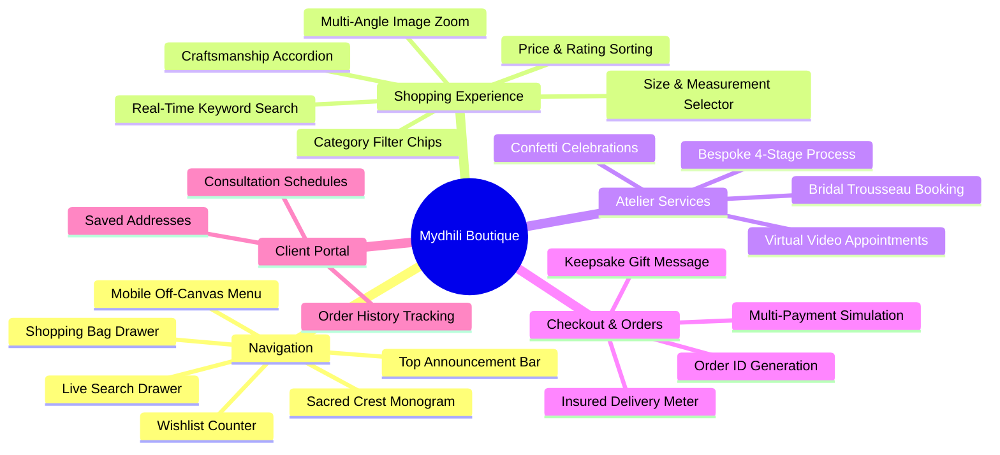

# Mydhili Boutique — Comprehensive Features & User Journey Guide

> **Version:** 1.0.0  
> **Target Audience:** Product Managers, QA Engineers, Full-Stack Developers  
> **Source References:** All components in [`src/components/`](file:///c:/CODE/FL/mydhili/src/components/) and views in [`src/pages/`](file:///c:/CODE/FL/mydhili/src/pages/)

---

## 1. Feature Map Overview

---

## 2. Navigation & Header System ([`Header.jsx`](file:///c:/CODE/FL/mydhili/src/components/Header.jsx))

### 2.1 Luxury Announcement Banner
- Displayed persistently across all page views at the apex of the screen.
- **Copy:** *"✦ COMPLIMENTARY INSURED WORLDWIDE ATELIER DELIVERY ON ORDERS ABOVE ₹50,000 | PRIVATE VIRTUAL BRIDAL APPOINTMENTS AVAILABLE ✦"*
- **Design:** Deep Imperial Burgundy background with Sovereign Gold typography (`0.72rem`, `letter-spacing: 0.18em`).

### 2.2 Sacred Crest & Wordmark
- Centered on desktop, left-aligned on mobile.
- Dynamically rendered through the parametric vector component [`MydhiliLogo.jsx`](file:///c:/CODE/FL/mydhili/src/components/MydhiliLogo.jsx).
- Clicking the logo instantly routes the client back to the `home` view with smooth scroll restoration.

### 2.3 Navigation Links
- Primary routes:
  1. **Home:** Flagship editorial experience.
  2. **Collections:** Comprehensive product catalog.
  3. **Bridal Couture:** Dedicated bridal ensembles and consultations.
  4. **Bespoke Atelier:** Custom 4-stage couture tailoring.
  5. **Our Craftsmanship:** Lineage, master weavers, and heritage.
  6. **Contact:** Atelier concierge and FAQs.

### 2.4 Action Icons & Quick Drawers
- **Search Toggle (`Search`):** Opens a sliding header drawer with instant auto-suggestion previews filtering by name, fabric, and category.
- **Wishlist Counter (`Heart`):** Shows a live badge with the number of saved heirlooms. Clicking routes to `/wishlist`.
- **Bag Counter (`ShoppingBag`):** Real-time badge counter displaying total cart quantity. Clicking opens the off-canvas `CartDrawer`.
- **Client Avatar (`User`):** Indicates client logged-in status and routes to the Sovereign Client Profile.
- **Mobile Menu (`Menu` / `X`):** Activates full-screen off-canvas navigation drawer on viewport widths `<= 768px`.

---

## 3. Flagship Editorial Homepage ([`HomePage.jsx`](file:///c:/CODE/FL/mydhili/src/pages/HomePage.jsx))

### 3.1 Cinematic Hero Section
- **Visuals:** High-resolution bridal editorial imagery draped in Imperial Burgundy gradient overlays.
- **Typography:** Display title *"Woven Heirlooms for the Sovereign Bride"* in Cormorant Garamond.
- **CTAs:** Dual luxury buttons:
  - *"Explore Bridal Couture"* (Navigates to `bridal`)
  - *"Book Bespoke Atelier"* (Navigates to `bespoke`)

### 3.2 Heritage Trust Markers
A four-pillar trust bar positioned beneath the hero:
1. **Pure Silver Zari:** Tested and certified genuine electroplated zari.
2. **Generational Weavers:** Direct artisan patronage in Kanchipuram & Varanasi.
3. **Slow Couture:** Up to 380 hours of meticulous hand needlework per ensemble.
4. **Keepsake Packaging:** 1400 GSM heirloom chest with antique gold wax seal.

### 3.3 Curated Bridal Highlights
- Showcases the pinnacle bridal lehengas and temple sarees.
- Integrated with [`ProductCard.jsx`](file:///c:/CODE/FL/mydhili/src/components/ProductCard.jsx) featuring hover zoom effects and instant wishlisting.

### 3.4 Bestseller Handlooms
- Dynamic display filtering products tagged with `'Bestseller'` or `'Master Weaver Series'`.

### 3.5 Bespoke Atelier Spotlight
- Explains the custom bridal creation journey with direct booking triggers.

---

## 4. Couture Catalog & Filtering ([`ShopPage.jsx`](file:///c:/CODE/FL/mydhili/src/pages/ShopPage.jsx))

### 4.1 Filter Chips & Categories
Clients can seamlessly filter through 6 distinct South Asian textile disciplines:
- **All Collections:** Entire repository of garments.
- **Bridal Couture:** Heavy zardozi lehengas and wedding ensembles.
- **Kanchipuram Silks:** Authentic Korvai temple sarees woven with 24K gold zari.
- **Banarasi Brocades:** Handspun Katan silks featuring Kadwa floral jaal motifs.
- **Kerala Kasavu:** Traditional Balaramapuram handloom sarees with gold kara borders.
- **Festive Silks:** Lighter celebratory silks for sangeet and reception ceremonies.
- **Bespoke Blouses:** Hand-embroidered maggam and zardozi blouses.

### 4.2 Real-Time Search & Sorting
- **Instant Search:** Evaluates query against product title, category, and fabric descriptions.
- **Sort Options:**
  - *Featured Heirlooms* (Default curated order)
  - *Price: High to Low* (Haute Couture first)
  - *Price: Low to High* (Ready-to-wear entry pieces)
  - *Highest Client Rating*

---

## 5. Product Detail Experience ([`ProductDetailPage.jsx`](file:///c:/CODE/FL/mydhili/src/pages/ProductDetailPage.jsx))

### 5.1 Interactive Imagery Suite
- High-definition multi-angle gallery with thumbnail switcher.
- Click-to-zoom interactive state for close-up inspection of bullion metal wire and intricate zari weave.

### 5.2 Product Metadata & Sizing
- Title, subtitle, price formatted in Indian Rupees (₹) with strike-through original prices.
- **Size Selector:** Chips for `'Free Size (Includes Unstitched Blouse)'`, `'Custom Bridal Fit'`, `'S'`, `'M'`, `'L'`, `'XL'`.
- **Quantity Selector:** Numeric stepper with boundary enforcement (`1` to `10`).

### 5.3 Specifications Accordion Tabs
1. **Heirloom Details:** Comprehensive fabric composition, colorway hex, and styling guidance.
2. **Craftsmanship:** Artisan hours invested, needlework technique (Zardozi, Gota Patti, Dabka), and weaving heritage.
3. **Care & Preservation:** Detailed preservation guidelines (Mulmul cotton wrapping, shade aeration, dry-cleaning rules).
4. **Insured Delivery:** Domestic vs international delivery schedules and transit insurance details.

### 5.4 Toast Feedback & Cross-Selling
- Adding an item triggers a gold toast confirmation: *"Added to your Bridal Keepsake Bag"*.
- Related drapes from the same textile category are rendered at the base of the page.

---

## 6. Bridal Concierge & Bespoke Atelier ([`BridalPage.jsx`](file:///c:/CODE/FL/mydhili/src/pages/BridalPage.jsx) & [`BespokePage.jsx`](file:///c:/CODE/FL/mydhili/src/pages/BespokePage.jsx))

### 6.1 The 4-Stage Bespoke Couture Journey
1. **Private Sketch & Ideation:** Moodboard development, silhouette mapping, and jewelry matching.
2. **Motif Drafting & Handloom Weaving:** Custom loom setup in Kanchipuram or Varanasi.
3. **Bullion Zardozi & Maggam Needlework:** Hand needlework by master artisans over 4 to 8 weeks.
4. **Private Trial & Couture Fit:** Atelier fitting with final draping adjustments.

### 6.2 Interactive Appointment Booking Forms
- Fields for bride's name, contact information, wedding milestone date, and service category.
- Preference for in-person atelier session (Chennai Flagship) or high-definition virtual diaspora consultation.
- Form submission triggers celebratory multi-color confetti (`canvas-confetti`) with gold, burgundy, and silk particles.

---

## 7. Shopping Bag Drawer ([`CartDrawer.jsx`](file:///c:/CODE/FL/mydhili/src/components/CartDrawer.jsx))

- Slide-over right drawer with backdrop blur.
- **Complimentary Delivery Progress Meter:** Visual indicator calculating amount needed to unlock complimentary insured shipping (Threshold: ₹50,000).
- Item controls: Quantity increment, decrement, and item removal.
- Selected size indicator for each line item.
- Live subtotal calculation in INR.
- One-click transition to `checkout` with automatic drawer dismissal.

---

## 8. Multi-Step Checkout ([`CheckoutPage.jsx`](file:///c:/CODE/FL/mydhili/src/pages/CheckoutPage.jsx))

### 8.1 Client Information & Destination
- Full name, email, phone number, physical address, city, state, postal code, and country.
- Custom handwritten gift note input field for the signature Mydhili Keepsake Chest.

### 8.2 Payment Simulation
- **Razorpay Secure Checkout:** Credit/Debit Cards, NetBanking, and Wallets.
- **UPI Instant Payment:** Direct QR / VPA payment flow via Google Pay, PhonePe, and Paytm.
- **Sovereign Concierge Wire:** Direct wire transfer with private atelier concierge assistance.

### 8.3 Order Confirmation Experience
- Processing simulation with loading spinner and security seal.
- Generates a unique order ID: `MYD-XXXXXX`.
- Dispatches celebratory full-screen confetti.
- Automatically clears the cart state in both memory and `localStorage`.

---

## 9. Sovereign Client Profile ([`AccountPage.jsx`](file:///c:/CODE/FL/mydhili/src/pages/AccountPage.jsx))

- **Client Header:** Sovereign client rank badge, client name, and primary atelier contact details.
- **Consultations Tab:** Displays scheduled private bridal atelier appointments with date, time, and couturier status.
- **Order History Tab:** Tracks historical heirloom purchases, courier tracking codes (e.g., `BLUEDART-APEX-8910248`), and delivery verification.
- **Profile Tab:** Primary shipping address and personal measurement profiles.

---

## 10. Supporting Pages ([`SupportingPages.jsx`](file:///c:/CODE/FL/mydhili/src/pages/SupportingPages.jsx) & [`AboutPage.jsx`](file:///c:/CODE/FL/mydhili/src/pages/AboutPage.jsx))

- **Atelier Contact:** Direct map address (Boat Club Road, Chennai), private appointment telephone line, and email desk.
- **FAQ Accordion:** Interactive collapsible panels answering essential client questions on lead times, diaspora virtual appointments, silver zari authenticity, packaging, and heirloom restyling.
- **Heritage Story:** Narrative detailing the brand's ethical artisan patronage, slow fashion principles, and revival of ancient temple motifs.
