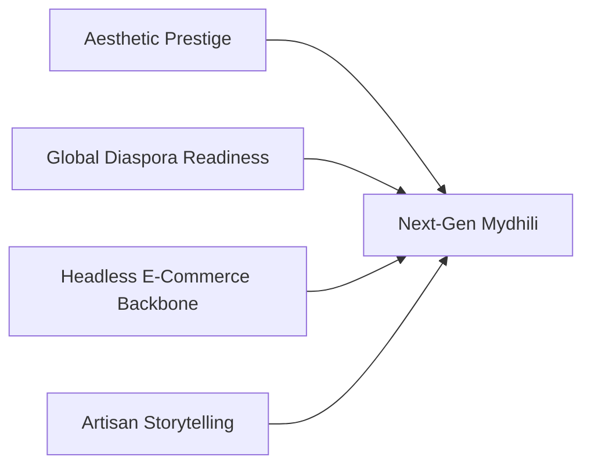

# Mydhili Boutique — Redesign Strategic Roadmap

> **Branch:** `redesign`  
> **Status:** Active Planning & Execution  
> **Target Audience:** Engineering Leads, Product Designers, E-Commerce Directors

---

## 1. Executive Summary & Branch Purpose

The `redesign` branch represents the evolution of **Mydhili Boutique** from an elegant luxury prototype into an elite, production-grade haute couture e-commerce atelier. 

The objective is to combine the aesthetic prestige of heritage South Asian royal courts with the cutting-edge performance, fluidity, and conversion optimization of modern high-end European digital flagships (e.g., Chanel, Sabyasachi, Hermès, Cartier).

---

## 2. Strategic Pillars

1. **Aesthetic Prestige:** Cinematic editorial layouts, fluid micro-animations, physical texture emulations (paper, silk, gold leaf).
2. **Global Diaspora Readiness:** Multi-currency support (INR, USD, GBP, AED, CAD) and virtual video appointments tailored for international bridal timelines.
3. **Headless E-Commerce Backbone:** Production integration with headless commerce APIs, real payment gateways, and automated logistics.
4. **Artisan Storytelling:** Deepening the connection between the client and the generational master weavers of Kanchipuram and Varanasi.

---

## 3. Planned Visual & UX Refinements

### 3.1 Digital Salon Enhancements
- [ ] **Interactive Zari Magnifier:** Lens zoom allowing clients to inspect the metallic bullion wire density and gold plating authenticity at `4x` optical resolution.
- [ ] **Audio Ambience (Optional):** Subtle, optional classical sitar/veena soundscape or audio narration of the saree's weaving history.
- [ ] **Physical Keepsake Packaging Unboxing:** Interactive 3D / video sequence showing the unboxing of the 1400 GSM Burgundy Keepsake Chest with wax seal breaking.
- [ ] **Custom Atelier Cursor:** Gold needlepoint cursor with smooth inertial trailing on desktop viewports.

### 3.2 Mobile-First Haute Couture Experience
- [ ] **Sticky Mobile Booking & Bag Bar:** Ultra-refined bottom glassmorphism bar on product pages with instant *"Add to Bag"* and *"Book Virtual Consultation"* triggers.
- [ ] **Swipe Gestures:** Native touch swiping for product image galleries and collection lookbooks.
- [ ] **WhatsApp Concierge Widget:** Direct, 1-click VIP WhatsApp bridge with the master couturier desk in Chennai.

---

## 4. Feature Roadmap & Deliverables

### Phase 1: Global Client Experience (Weeks 1 - 2)
- **Multi-Currency Switcher:**
  - Support for `INR (₹)`, `USD ($)`, `GBP (£)`, `EUR (€)`, `AED (د.إ)`, `CAD ($)`, and `AUD ($)` with live exchange rates.
- **Virtual Bridal Measurement Guide:**
  - Interactive silhouette diagram guiding brides on how to accurately take 14 custom measurements for bespoke bridal blouses and lehengas.
- **Physical Silk Swatch Box Order:**
  - Allow brides to order an authentic fabric swatch box (Mulberry silk, velvet organza, gold tissue) credited against their final wedding ensemble order.

### Phase 2: Headless Backend & Payment Gateways (Weeks 3 - 5)
- **Headless Commerce Engine:**
  - Evaluate and integrate **MedusaJS** or **Shopify Storefront GraphQL API**.
- **Payment Gateway Integration:**
  - **Razorpay Production Mode:** Domestic Indian UPI, Cards, NetBanking, and EMI.
  - **Stripe Elements:** Multi-currency checkout, Apple Pay, and Google Pay for international clients.
- **Automated Communication:**
  - Real-time order invoices generated via PDF with brand monogram watermark.
  - WhatsApp and SMS notifications for order dispatch and consultation reminders.

### Phase 3: Performance, Accessibility & Code Quality (Weeks 6 - 8)
- **TypeScript Migration:** Convert `.jsx` files to `.tsx` with strict typing using the schemas defined in [`docs/DATA_SCHEMA.md`](file:///c:/CODE/FL/mydhili/docs/DATA_SCHEMA.md).
- **Lighthouse Performance Benchmarks:**
  - Performance: `> 95`
  - Accessibility: `100` (WCAG 2.1 AA compliant contrast ratios across gold on burgundy).
  - Best Practices: `100`
  - SEO: `100` with OpenGraph bridal rich snippets and Schema.org `Product` microdata.
- **Image Optimization:** Migrate image hosting to a dedicated CDN (Cloudinary / ImageKit) with automatic AVIF and WebP generation.

---

## 5. Branch Workflow & Merge Criteria

To merge the `redesign` branch into `main`:
1. **Zero Oxlint / ESLint Errors:** Clean run of `npm run lint`.
2. **Production Build Clean:** `npm run build` generates clean bundles with zero warnings.
3. **Responsive Visual Review:** Verification across Mobile (375px), Tablet (768px), and Desktop (1440px+).
4. **Documentation Parity:** Ensure any component or state changes are reflected in `docs/`.
